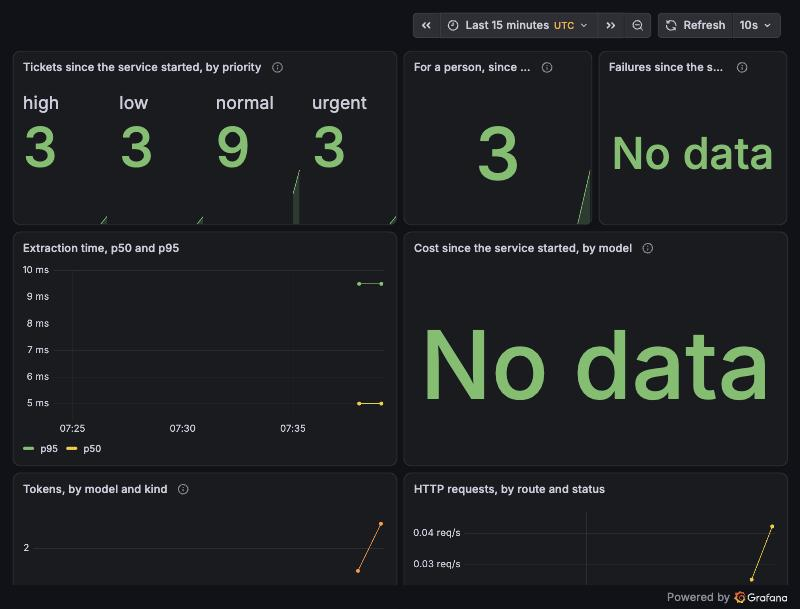

# Ticketdesk intake: a Claude-powered service, running

The capstone of the portfolio. An email arrives over HTTP; the extractor from `claude-structured-extraction`
turns it into fields with the Claude API; the desk's rules (from the other repositories) give it a
priority and a response deadline in business hours; it is stored, and anything the extraction could not
settle goes to a person. It runs in Docker beside an OpenTelemetry stack, with a dashboard and a runbook,
and deploys to Kubernetes: a local cluster you can start in a couple of minutes, with the same manifests a
cloud's managed Kubernetes would take.



*The dashboard on the running stack, in scripted mode: 18 requests, 18 tickets, a p95 extraction time of
9.5 ms, and no cost, because scripted mode calls no model.*

## The history is the point

Each stage is a branch merged into `main` with a merge message written like a pull request.

```bash
git log --first-parent --reverse --format='%h %s' main
git log --graph --format='%h %s%n%b' main
```

| # | Stage | The problem it answers |
|---|---|---|
| 1 | An email in, an extracted, prioritised ticket out | (none yet) |
| 2 | `telemetry` | Nobody could see what the service did or spent |
| 3 | `run-locally` | It had only ever run inside a test |
| 4 | `production-concerns` | A model failure lost the customer's email; retries duplicated tickets; bursts piled up |
| 5 | `operations` | Only the author could run it, and nothing said how it would be deployed |

Three faults were found by looking at the running system, not by the tests, and each is in the commit
that fixed it:

- **The p95 extraction time read 4.75 s** for extractions taking about 10 ms. OpenTelemetry's default
  histogram buckets are sized for milliseconds; recorded in seconds, every extraction fell in the first
  bucket. Fixed with boundaries in seconds, and a test that pins them.
- **Ticket counts were fractional,** because `increase()` extrapolates across the range.
- **Then they were too low:** 12 requests read as about 7, because `increase()` cannot see the first
  value of a new counter series. Count panels now read the service's cumulative counters; 18 requests
  read 18.

## What it demonstrates

| Area | Where to look |
|---|---|
| **A Claude API integration as a service**, reusing a tested extractor | [`Intake.cs`](src/Ticketdesk.Intake/Intake.cs), [`Program.cs`](src/Ticketdesk.Intake/Program.cs), [vendored library](src/Ticketdesk.Extraction/VENDORED.md) |
| **Graceful degradation**: a refusal, an invalid reply or an unreachable API keeps the email, for a person | [ADR 0001](docs/adr/0001-an-email-is-never-lost-to-the-model.md), [tests](tests/Ticketdesk.Intake.Tests/ProductionTests.cs) |
| **Idempotency, concurrency limits, problem details** | [`Program.cs`](src/Ticketdesk.Intake/Program.cs) |
| **Observability**: traces including the model call, metrics for tickets, failures, tokens, cost and time | [`Telemetry.cs`](src/Ticketdesk.Intake/Telemetry.cs), [tests](tests/Ticketdesk.Intake.Tests/TelemetryTests.cs) |
| **No customer data in telemetry or logs**, tested | [`TelemetryTests`](tests/Ticketdesk.Intake.Tests/TelemetryTests.cs), [`ProductionTests`](tests/Ticketdesk.Intake.Tests/ProductionTests.cs) |
| **Dashboards as code**, provisioned into Grafana | [`grafana/`](grafana) |
| **Containers**: multi-stage build, chiseled runtime, non-root, no shell | [`Dockerfile`](Dockerfile), [`compose.yaml`](compose.yaml) |
| **Running without a key**: scripted mode replaces only the model's reply | [`ScriptedGateway`](src/Ticketdesk.Intake/ScriptedGateway.cs) |
| **Deployment on Kubernetes**: autoscaling sized against the API, the key from a Secret, its own identity with no API access, a restricted non-root read-only container, probes, limits, a network policy, and what changes on a cloud | [`deploy/`](deploy), [ADR 0002](docs/adr/0002-size-the-service-against-the-api-and-keep-the-key-out-of-config.md), [`cluster-up.sh`](scripts/cluster-up.sh) |
| **Deployment safeguards checked in the build**: the rendered manifests must keep every one of them | [`check-deploy.py`](scripts/check-deploy.py) |
| **Operations**: what each response means and what to do when the dashboard moves | [runbook](docs/runbook.md) |

## Run it

Needs Docker; the build also needs the .NET 10 SDK.

```bash
./build.sh                       # 24 tests in memory, and the deployment's safeguards checked
docker compose up -d --build     # the service on 127.0.0.1:8080, Grafana on 127.0.0.1:3000
```

Or on a local Kubernetes cluster (needs Docker, [kind](https://kind.sigs.k8s.io/) and kubectl):

```bash
scripts/cluster-up.sh            # three nodes, the service, metrics-server and the telemetry stack
scripts/cluster-down.sh          # remove it all
```

Then follow the [runbook](docs/runbook.md). Scripted mode is the default and costs nothing; live mode
needs an API key in an ignored `.env`, and a spend limit on the key.

## What has and has not been verified

- **Verified by the build:** the intake path, the desk's rules, every failure route keeping the email,
  idempotency (including two requests with one key at the same moment), the concurrency limit and its 503s, input limits, telemetry content and histogram
  boundaries, the absence of customer text from spans, metrics and logs, and the deployment's safeguards
  (shown failing on planted breaches).
- **Verified on the running stack, in scripted mode:** the container (chiseled, uid 1654, no shell);
  requests producing the expected priorities and deadlines; 201, 200 on a repeated key, 400 on an empty
  email; traces in Tempo; metrics in Prometheus; the dashboard, after the three fixes above; log lines
  holding ids and outcomes only.
- **Verified on a local Kubernetes cluster** (kind, three nodes, scripted mode): it deployed and passed
  its probes in a namespace enforcing the restricted pod security standard, which refused a root
  container; the pod ran as uid 1654 with a read-only filesystem and no API token; a ticket was created,
  and a retry with its key returned it; the cluster's Prometheus counted every ticket sent, and Grafana
  loaded the dashboard; under load the autoscaler went from one replica to its ceiling of three, across
  both workers, with no restarts.
- **Run on GitHub:** `./build.sh`, by the `build` workflow on every push to `main` and every pull request.
- **Not yet verified:** live mode against the Claude API, locally or on the cluster (`--live`), which needs a
  decision about spending money; and a cloud deployment, with the changes ADR 0002 lists (a registry, a
  secret store through workload identity, an enforcing network plugin, TLS).

## Layout

```
compose.yaml, Dockerfile     the stack
docs/adr/                    why each decision was made
docs/runbook.md              running it, and what to do when it misbehaves
docs/images/                 the dashboard on the running stack
grafana/                     the dashboard, as code
deploy/                      the Kubernetes deployment, the kind cluster, and a pinned metrics-server
src/Ticketdesk.Intake/       the service
scripts/                     start and stop the local cluster; check the deployment's safeguards
src/Ticketdesk.Extraction/   the extractor, vendored from claude-structured-extraction
tests/                       every test, in memory, none of which calls a model
build.sh                     the gate
```
